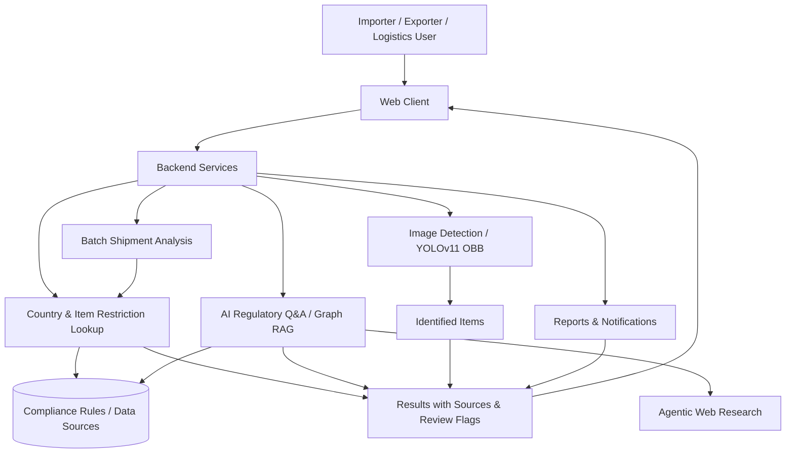
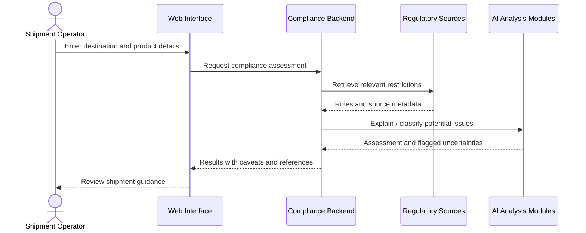

# Rapid-Compliance-Checker
### Intelligent Cross-Border Trade & Shipment Compliance

**An AI-assisted platform for researching shipment restrictions, checking prohibited goods, and navigating country-specific trade requirements.**

[](https://iitb-one.vercel.app/)


[Overview](#overview) · [Features](#key-capabilities) · [Architecture](#architecture) · [Setup](#getting-started) · [Workflow](#example-compliance-workflow) · [Roadmap](#roadmap)

</div>

## Overview

Cross-border shipments must comply with product restrictions, destination-country rules, carrier policies, and changing documentation requirements. Manually searching across government portals, carrier websites, and regulatory documents can be slow and inconsistent.

**Rapid Compliance Checker** explores a unified interface to support this work. The project brings together AI-assisted regulatory research, item identification, prohibited-goods checks, and automated compliance summaries.

## The Problem

- Shipping rules differ across destination countries and product categories.
- Operators often have to consult multiple sources to check whether an item is restricted.
- Manual handling of high-volume shipment records is difficult to scale.
- Non-specialists need understandable explanations and links to authoritative sources.

## Key Capabilities

The original project documentation describes the following modules:

| Module | Intended experience | Documented technology / technique |
|---|---|---|
| Regulatory knowledge base | Ask about country-specific shipping requirements | Graph retrieval-augmented generation (Graph RAG) |
| Prohibited-item checks | Search by product or destination country | Country/item matching and rule lookup |
| Image-based inspection | Upload a product image to identify possible items | YOLOv11 oriented bounding-box (OBB) object detection |
| Bulk shipment checks | Submit multiple shipment entries in a CSV file | Batch processing / service architecture |
| AI assistant | Ask follow-up questions about shipment restrictions | Conversational AI with context |
| AI research agents | Gather and summarize regulatory information | Agentic workflows and web research |
| Reporting and sharing | Export findings and communicate them to stakeholders | PDF, CSV, email, SMS / WhatsApp integrations described |
| Accessibility | Provide assistance in multiple languages | Multilingual support described |
| Adaptive analysis | Experiment with feedback-driven compliance guidance | Reinforcement learning module |

## Architecture



### High-Level Technology Stack

| Layer | Technology described in existing documentation |
|---|---|
| Frontend | React (the original README also references Vue.js; verify the actual client implementation) |
| Backend | Python, Flask |
| Database | MongoDB |
| AI and retrieval | Graph RAG, AI agents / CrewAI |
| Computer vision | YOLOv11 OBB |
| Learning experiments | Reinforcement learning |
| Notifications | Twilio, email-related services |
| Mobile | React Native (documented; verify actual mobile application entry point) |
| Deployment | A Vercel-hosted demo URL is linked in the repository |

## Repository Structure

The following top-level directories were visible in the public repository:

```text
Logithon_IITB_Hackathon/
├── block1/
├── client/                 # Client-side application (inspect package.json)
├── code-1/
├── code-2/
├── code-3/
├── myapp/
├── reinforcement_agent/    # Reinforcement-learning-related module
├── server/                 # Server-side application (verify startup file)
├── functionality-1/
├── functionality-2/
├── .gitignore
├── README.md
├── package-lock.json
└── requirements.txt
```

## Getting Started

### Prerequisites

- Git
- Python 3 and `pip`
- Node.js and `npm`, if the `client/` package uses them
- Credentials for any configured external AI, messaging, database, or regulatory data providers

### 1. Clone the actual repository

```bash
git clone https://github.com/purav-12345/Rapid-Compliance-Checker.git
cd Rapid-Compliance-Checker
```

### 2. Create the Python environment

```bash
python -m venv .venv
# macOS / Linux:
source .venv/bin/activate
# Windows PowerShell:
# .venv\Scripts\Activate.ps1
pip install -r requirements.txt
```

### 3. Start the web client

If `client/package.json` is present and contains the expected scripts:

```bash
cd client
npm install
npm run dev
```

### 4. Set configuration securely

Create local `.env` files only where the code reads them, for example:

```dotenv
# Illustrative variable names only — match them to the implementation
MONGODB_URI=<your-database-connection>
AI_API_KEY=<your-provider-key>
TWILIO_ACCOUNT_SID=<your-sid>
TWILIO_AUTH_TOKEN=<your-token>
```

##Compliance Workflow



**Questions the platform is intended to support:**

- Can this product be shipped to a specified destination?
- Which countries restrict a selected category of goods?
- Which documents or checks might be required?
- Which shipments in a bulk upload need manual review?

## Responsible Use & Limitations

- Regulations change frequently; include the source URL and retrieval date in any compliance report.
- A model-detected object is not necessarily the correct customs classification or HS code.
- Carrier restrictions and government import/export laws are separate requirements.
- Low-confidence, conflicting, or unavailable rules should trigger manual review rather than automatic approval.
- The original project's performance claims need a reproducible dataset, evaluation script, and test conditions before being cited as established results.
- This repository's accessible files do not establish compliance certification, regulatory approval, or production-grade security.

## Roadmap

- [ ] Verify and document exact service entry points, ports, and environment variables.
- [ ] Add automated tests for rules, endpoints, and CSV ingestion.
- [ ] Attach official source URLs and timestamps to every compliance result.
- [ ] Publish model cards and reproducible evaluation for image detection and retrieval.
- [ ] Add role-based access controls and secure audit logs.
- [ ] Add end-to-end tests for bulk shipment workflows.
- [ ] Provide a reproducible containerized deployment configuration.
- [ ] Add dashboard screenshots and a short product demo.

## License
---

<div align="center"><strong>TradeGuard AI</strong> — Turning fragmented shipping rules into understandable, reviewable decisions.</div>
